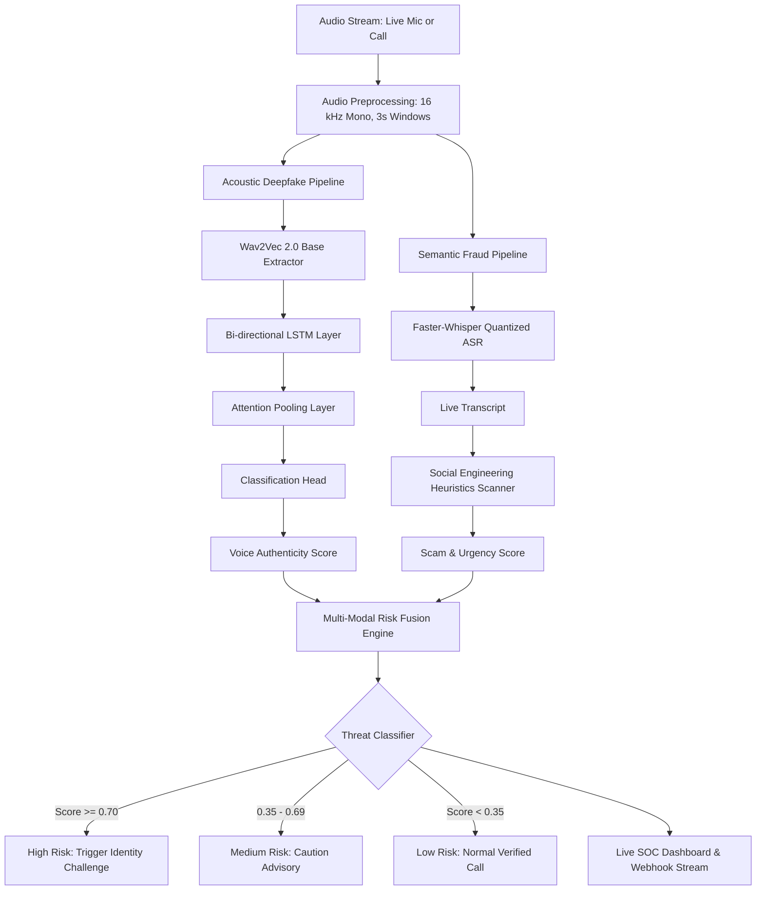

# 🛡️ VoiceGuard: Real-Time AI Voice Cloning & Fraud Detection System

<p align="center">
  
  
  
  
  
  
</p>

<p align="center">
  <strong>An intelligent multi-modal security framework engineered to detect generative AI voice clones and social engineering phone scams in real time.</strong>
</p>

---

## 📌 The Problem & The Solution

With recent advances in zero-shot generative audio models (such as XTTS, ElevenLabs, VALL-E, and Bark), cybercriminals can now clone an individual's voice from just a 3-second audio sample. These cloned voices are increasingly weaponized in **CEO fraud, bank credential phishing, and emergency extortion scams**.

Traditional caller ID and telephony spam filters fail completely against voice clones because the attacker speaks with the genuine cadence and timbre of someone the victim trusts.

**VoiceGuard** solves this threat with a **Multi-Modal Dual-Engine Pipeline**:
- **Acoustic Deepfake Engine:** Detects sub-perceptual vocoder artifacts, synthetic phase discontinuities, and neural synthesis signatures directly from the raw audio waveform.
- **Semantic Threat Engine:** Simultaneously transcribes the ongoing conversation to detect high-pressure social engineering tactics, urgency triggers, and financial/credential demands.
- **Fused Risk Engine:** Combines both vectors into a single real-time threat score that alerts the user and triggers active verification challenges.

---

## 🏗️ System Architecture

VoiceGuard processes incoming audio through two synchronized, parallel streams before fusing them into an actionable threat evaluation.

### Flow Diagram



---

### End-to-End Pipeline Breakdown

```
Incoming Call Audio (Microphone / VoIP Stream)
   │
   ├──▶ 1. Audio Normalizer
   │       • Resampled to 16,000 Hz, single-channel mono
   │       • Windowed into 3-second evaluation segments (48,000 samples)
   │
   ├──▶ 2. Parallel Processing Engines
   │       │
   │       ├── [Engine A: Acoustic Spoof Detection]
   │       │     • Wav2Vec 2.0 Base: Extracts 768-dim temporal latent embeddings
   │       │     • Bi-directional LSTM (hidden=128): Tracks bi-directional prosody
   │       │     • Attention Pooling: Dynamically weights anomaly frames
   │       │     • MLP Classifier: Generates synthetic voice probability [0.0 - 1.0]
   │       │
   │       └── [Engine B: Semantic Fraud Detection]
   │             • Faster-Whisper: Fast quantized speech-to-text transcription
   │             • Pattern Engine: Identifies OTP, CVV, wire transfer, urgency cues
   │             • Sentiment & Pressure Scoring: Generates scam intent score [0.0 - 1.0]
   │
   └──▶ 3. Unified Risk Fusion Engine
           • Formula: Combined_Score = (Voice_Confidence × 0.6) + (Scam_Score × 0.4)
           • Triages call into Low / Medium / High threat levels
           • Triggers automated callback / challenge prompts upon high threat
```

---

## 📊 Datasets & Training Methodology

VoiceGuard was trained and validated using a combination of gold-standard academic benchmarks and a custom-collected domain adaptation dataset:

### 1. ASVspoof 2019 Logical Access (LA) Benchmark
- **Total Utterances:** **121,463 audio files**
  - **Training Set:** 25,380 utterances
  - **Development Set:** 24,844 utterances
  - **Evaluation Set:** 71,237 utterances
- **Attack Coverage:** Covers **19 distinct spoofing algorithms (A01 to A19)**, encompassing both state-of-the-art Text-to-Speech (TTS) synthesis and Voice Conversion (VC) techniques.
- **Strict Disjoint Speaker Split:** Partitioned with an **80/20 zero-leakage speaker split** (`make_speaker_split.py`), ensuring that validation speakers are never seen during training, evaluating true zero-shot generalization.

### 2. In-the-Wild Custom Voice Cloning Dataset
To bridge the domain shift between benchmark datasets and modern real-world phone calls, we collected and prepared a dedicated real-world dataset (`data/real` and `data/cloned`):
- **Bonafide Samples:** Multi-speaker real conversational speech across diverse acoustic environments and microphone profiles.
- **Synthesized Spoofs:** Cloned audio generated using modern zero-shot neural synthesis engines (including modern diffusion- and autoregressive-based voice cloners) mimicking real-world impersonation scams.
- **Feature Extraction:** Pre-computed 768-dimensional frame embeddings via `facebook/wav2vec2-base-960h` stored in high-throughput memory-mapped arrays (`memmap`) for rapid training convergence.

---

## ⚡ Core Features

- 🎙️ **Dual-Engine Fusion:** Acoustic deepfake detection paired with conversational intent analysis prevents both false positives on benign synthetic audio and false negatives on human-driven fraud.
- ⏱️ **Sub-Second Latency:** Evaluates rolling 3-second chunks so threats are detected before a financial transaction or credential transfer takes place.
- 🎯 **Attention-Guided Neural Architecture:** Attention pooling isolates brief artifact bursts rather than averaging them out across entire utterances.
- 🚨 **Social Engineering Detection:** Built-in heuristic categories:
  - **Credential Phishing:** OTPs, verification codes, passcodes, PINs, CVVs.
  - **Financial Coercion:** Demands to wire money, transfer funds, or buy gift cards.
  - **Banking Alerts:** Fake account suspension and unauthorized transaction warnings.
  - **Artificial Urgency:** Demands for immediate action designed to panic the victim ("right now", "do not wait", "immediately").
- 🖥️ **SOC Dashboard:** Real-time dark-mode security console with live waveforms, threat level badges, live transcription feed, and risk gauges.

---

## 📁 Repository Organization

```plaintext
voiceguard/
├── app.py                            # FastAPI server & WebSocket/REST endpoints
├── voiceguard_pipeline.py            # Core pipeline coordinator (Wav2Vec2 + Whisper + Classifier)
├── risk_engine.py                    # Multi-modal acoustic & semantic fusion logic
├── scam_detector.py                  # Real-time social engineering pattern detector
├── requirements.txt                  # Python dependencies
│
├── frontend/                         # Modern SOC Web Dashboard
│   ├── index.html                    # Main security analyst dashboard
│   ├── style.css                     # Glassmorphic dark security theme
│   ├── app.js                        # Audio capture and WebSocket client
│   ├── demo.html                     # Interactive evaluation console
│   ├── demo.css                      # Demo console styles
│   └── demo.js                       # Audio playback and threat visualization
│
├── ml_rebuild/                       # Model Training & Benchmark Suite
│   ├── models/
│   │   └── voiceguard_v2a.pth        # Trained V2-A PyTorch model checkpoint
│   ├── training/
│   │   ├── train_v2.py               # V2-A training with WeightedRandomSampler
│   │   ├── evaluate_v2.py            # Comprehensive evaluation on eval split
│   │   ├── threshold_v2.py           # Decision threshold optimization
│   │   ├── extract_train_embeddings.py
│   │   ├── extract_val_embeddings.py
│   │   └── prepare_memmap.py         # Fast memory-mapped embedding pipeline
│   ├── audit_dataset.py              # ASVspoof protocol parsing & integrity audit
│   └── make_speaker_split.py         # Zero-leakage speaker-disjoint split generator
│
└── README.md                         # Documentation
```

---

## 🚀 Quickstart & Installation

### Prerequisites
- **Python**: 3.10 or higher
- **FFmpeg**: Required for audio decoding (`winget install Gyan.FFmpeg` on Windows, `sudo apt install ffmpeg` on Linux)
- **Git**

### 1. Clone the Repository
```bash
git clone https://github.com/darshinidurga/sih26104-voice-guard.git
cd sih26104-voice-guard
```

### 2. Create and Activate a Virtual Environment
```bash
# Windows
python -m venv .venv
.venv\Scripts\activate

# macOS / Linux
python3 -m venv .venv
source .venv/bin/activate
```

### 3. Install Dependencies
```bash
pip install --upgrade pip
pip install -r requirements.txt
```

### 4. Run the Application
```bash
uvicorn app:app --host 0.0.0.0 --port 8000 --reload
```

Access the application in your browser:
- **SOC Security Dashboard:** `http://localhost:8000/`
- **Evaluation Console:** `http://localhost:8000/demo`
- **Interactive Swagger API Docs:** `http://localhost:8000/docs`

---

## 📡 API Reference

### Analyze Audio Segment
`POST /demo/analyze`

**Request:** `multipart/form-data`
- `file`: Audio file (`.wav`, `.mp3`, `.m4a`)
- `source`: `"microphone"` or `"upload"`

**Example Response:**
```json
{
  "voice_classification": "SYNTHETIC / CLONED VOICE",
  "voice_confidence": 0.98,
  "is_fake": true,
  "transcript": "Hello, this is your bank manager. Your account has been suspended. Please share your one-time password immediately to verify your identity.",
  "scam_score": 0.85,
  "risk_level": "high",
  "urgency_detected": true,
  "matched_phrases": [
    "account has been suspended",
    "one-time password",
    "immediately"
  ],
  "trigger_challenge": true
}
```

### Health Check
`GET /health`
```json
{
  "status": "ok"
}
```

---

## 🛡️ Threat Detection Matrix

| Category | High-Risk Indicators | Risk Weight |
|:---|:---|:---:|
| 🔑 **Credential Theft** | OTP, verification code, password, PIN, CVV | **Critical (0.35)** |
| 💳 **Financial Demands** | "Send money", "transfer funds", "wire payment" | **High (0.30)** |
| 🏦 **Banking Exploitation** | "Bank account", "account suspended", "card blocked" | **High (0.25)** |
| 🎁 **Alternative Rails** | "Gift card", "crypto voucher", "cash card" | **High (0.25)** |
| ⏱️ **Artificial Urgency** | "Immediately", "right now", "urgent", "don't wait" | **Multiplier (+0.15)** |

---

## 📜 License

This project is licensed under the [MIT License](LICENSE).
